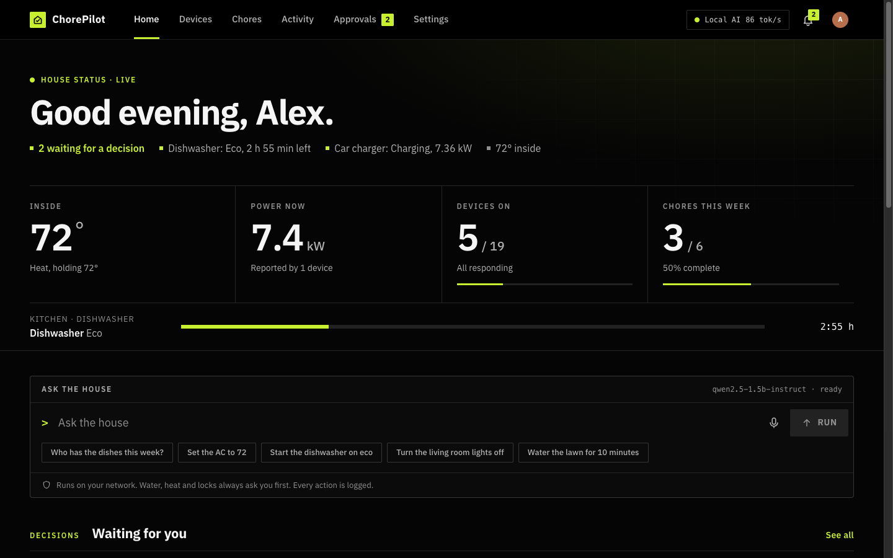
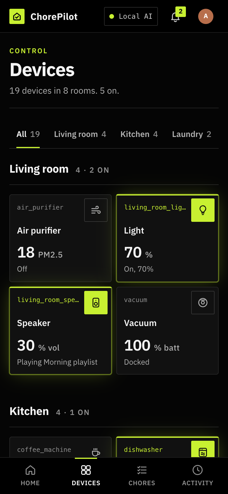
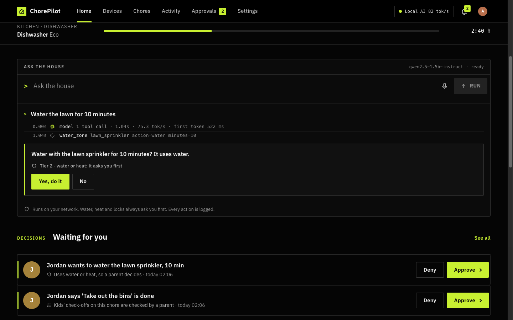

# ChorePilot

**ChorePilot, your smart-home AI agent assistant: local-first, runs your appliances and keeps
the household's chores fair.**

You talk to it (terminal, Telegram, a web dashboard, or any MCP agent) and it does two jobs:

1. **It runs the house.** Dishwasher, washer, dryer, lights, blinds, thermostat / AC, water
   heater, sprinklers, coffee machine, oven, fridge, robot vacuum, air purifier, humidifier,
   speakers and TVs, EV charger, door locks, garage door, alarm panel. The model only *asks*; a
   policy engine decides, from who is asking and how risky the action is.
2. **It keeps the chores fair.** People, chores, schedules, rotations, points, reminders and
   approvals, and where it can it **verifies a chore from the device itself**: when the
   dishwasher finishes, "Run the dishwasher" is done, the credit goes to whoever started it, and
   "Empty the dishwasher" opens for the next person in that chore's rotation.

The model runs on your own hardware through any OpenAI-compatible server (llama.cpp's
llama-server, Ollama, LM Studio, vLLM). Everything stays local: a SQLite file, an append-only
audit log, no account, no telemetry. It is stdlib-only Python, so it installs anywhere from a
Pi Zero to a NAS, and **whoever installs it owns it**: `chorepilot setup` creates your household
with you as the owner. Nothing about anyone else's home is baked in.

> ChorePilot started as **Dishsoaker3000**, a joke about running an LLM on a dishwasher. Then
> the LLM got to actually wash the dishes, then to say whose turn it is to empty them. The
> LLM-on-anything bits still work ([below](#llms-on-anything-the-dishsoaker3000-bits)), and
> `dishsoaker` and `wash` are aliases for `chorepilot`.

## Features

- **Local-first.** Your model, your box, your data. A 1.5B-4B instruct model is enough.
- **One safety model everywhere.** Terminal, Telegram, dashboard and MCP agents all go through
  the same policy engine: read / low / water-heat / security tiers, roles, confirmations,
  a kids' approval queue, owner PIN or TOTP for security actions.
- **Device-verified chores.** Rotations (round robin, least points, weekly), deterministic
  schedules, follow-ups, points, quiet hours, reminders.
- **Talks to what you have.** Home Assistant (so anything HA supports, including Matter), the
  official Home Connect API (Bosch, Siemens, Neff, Gaggenau), MQTT / ESPHome, and a simulator to
  try everything first.
- **First-run wizard.** `chorepilot setup`: owner + PIN + authenticator QR code, members, model
  detection and a hardware-based model recommendation, Home Assistant entity discovery, Home
  Connect login, Telegram bot walkthrough, MCP tokens, sensible default chores.
- **Works with Grok Bot / Claude / any MCP client**, without ever letting an agent unlock a
  door.
- **Runs as a service**: `chorepilot run` starts everything you configured; pipx, Docker,
  a Home Assistant add-on, systemd and launchd files are included.

## Quick start

**pipx** (any Linux / macOS / Raspberry Pi OS):

```bash
pipx install chorepilot          # once on PyPI; today: pipx install . (in a checkout) or a git URL
chorepilot setup                 # the wizard: you become the owner
chorepilot run                   # Telegram + device events + MCP + the dashboard
chorepilot service install       # optional: keep it running (systemd user unit / launchd agent)
```

**Docker** (next to Home Assistant or anything else):

```bash
docker compose build
docker compose run --rm chorepilot setup     # interactive, state in ./data
docker compose up -d                         # dashboard on http://127.0.0.1:8771
```

**Home Assistant add-on**: add `packaging/homeassistant/` as an add-on repository (run its
`sync.sh` first when building from a checkout), set your name and PIN in the options and start
it. It reaches Home Assistant through the Supervisor (no token to paste) and maps your entities
on first start. See [packaging/homeassistant/chorepilot/DOCS.md](packaging/homeassistant/chorepilot/DOCS.md).

**Just trying it?** `chorepilot setup --simulated` adds a simulated house (every device type),
so nothing real is touched.

### What `chorepilot setup` asks

| Step | What happens |
|---|---|
| owner | the household's name, your name (you become the **owner**), your PIN, optionally an authenticator app: a QR code is printed in the terminal (`--qr-file` writes PNG/SVG), and you type a code back to check it |
| members | adults, kids (quiet hours 21:00-07:00 by default), guests; optional PINs for the dashboard |
| model | finds llama-server, Ollama, LM Studio or vLLM on this machine (or takes any OpenAI-compatible URL on the LAN); if none runs, it probes this machine's RAM and recommends a model size, or the best GGUF already on disk |
| devices | Home Assistant URL + long-lived token: lists your entities and suggests a mapping (lights, climate, locks, covers and garage doors, alarm panel, media players, water heaters, humidifiers, purifiers, EV charger switches, sprinkler valves); Home Connect device-flow login and the appliances on your account; an MQTT broker; single devices with `--device` |
| telegram | how to create **your own** bot with @BotFather, the token (saved 0600), a one-time `/link` code for each person |
| mcp | one token per outside agent (shown once, stored hashed) |
| chores | defaults that fit your devices and people (run / empty the dishwasher, laundry, folding, trash, recycling, vacuum, bathroom, lawn), also written to `chores.json` for you to edit and re-import |

Every step can be re-run on its own (`chorepilot setup devices`, `setup telegram`, ...) and
`chorepilot setup status` shows what is configured. Everything works non-interactively too:

```bash
chorepilot setup --non-interactive --household "Our home" --owner Alex --owner-pin 2468 --totp \
    --member Sam:adult --member Jordan:kid --model-url auto \
    --ha-url http://homeassistant.local:8123 --ha-token "$HA_TOKEN" --mcp-client claude-desktop
```

**Ownership.** The person who runs setup is the owner and the default identity at this
machine's terminal. Several owners are supported: adding one needs an existing owner's PIN or
TOTP (`chorepilot setup owner`, or `people set-role <name> --role owner`), and
`chorepilot people transfer-owner <name>` hands the household over (`--keep` to stay a co-owner).
The last owner can never be demoted by accident.

## A fresh install, recorded

This ran on an M4 Mac in an empty temporary `HOME` (`scripts/fresh_install_demo.sh`) with a
**Qwen2.5-1.5B-Instruct Q4_K_S GGUF (0.94 GB)** on llama-server, against the simulated house.
Shortened, not edited:

```
$ chorepilot people list
nobody yet: run `chorepilot setup` (you become the owner)

$ chorepilot setup --non-interactive --household "Our home" --unit F --owner Alex --owner-pin 2468 --totp \
    --member Sam:adult:1357 --member Jordan:kid:1111 --member Riley:kid \
    --model-url http://127.0.0.1:8092 --simulated --mcp-client claude-desktop --chores default
== The household and its owner ==
  Alex is the owner of Our home
  PIN set for Alex (stored as a PBKDF2 hash)
  Scan this with your authenticator app (Google Authenticator, Aegis, 1Password, Authy ...):
  [QR code]
== Household members ==
  added Sam (adult)
  added Jordan (kid), quiet hours 21:00-07:00
  ...
== The local model ==
  using http://127.0.0.1:8092
== Devices ==
  added 19 simulated devices
== Outside agents (MCP) ==
  claude-desktop acts as Alex (owner). Token, shown once: cp_...
== Chores ==
   [1] Run the dishwasher       daily at 19:30                       Alex, Sam, Jordan, Riley
   [2] Empty the dishwasher     on demand                            Jordan, Riley
   [3] Laundry                  every monday and thursday at 18:00   Alex, Sam
   ...

$ chorepilot ask "wash my dishes"                     # no --as: the person who set it up
  [tool call ] start_program({"appliance": "dishwasher", "program": "auto"})
  ?? Start auto on the dishwasher (Bosch SMV6ZCX42E, simulated)? It uses water and heat. [y/N] y
  [house     ] {"ok": true, "state": "running", "remaining": "2 h 39 min", "program": "auto"}  (policy: confirm, tier 2)
Your dishes are now being washed in the dishwasher. It will take approximately 2 hours and 39 minutes.
  [done      ] 4.1s, 2 model turn(s), 77.0 tok/s

$ chorepilot ask "who has the dishwasher this week?" --as Sam
  [tool call ] who_has({"chore": "Run the dishwasher"})
Alex has the dishwasher this week. It's due today at 19:30.

$ chorepilot events poll                              # ... once the dishwasher has finished
  [event     ] dishwasher: finished
  [chores    ] 'Run the dishwasher' done by Alex, verified by the dishwasher.
  [chores    ] 'Empty the dishwasher' is now open for Jordan.

$ chorepilot ask "open the garage door"
  [tool call ] garage_door({"device": "garage", "action": "open"})
  ## Open the garage? Alex, enter your ChorePilot PIN or TOTP code:
  [house     ] {"ok": true, "device": "garage", "action": "open", "state": "open"}  (policy: second_factor, tier 3)

$ chorepilot ask "close the garage door" --as Jordan  # a kid: closing is tier 1
  [house     ] {"ok": true, "device": "garage", "action": "close", "state": "closed"}  (policy: allow, tier 1)

$ chorepilot ask "charge the car" --as Jordan
  [tool call ] ev_charger({"device": "car_charger", "action": "start_charging", "current": 32})
  [house     ] {"ok": false, "queued_for_approval": 1, ...}  (policy: approval, tier 2)
I've sent the request to the parents to approve the charging of your car.

# Sam signs in to the dashboard with a PIN and presses Approve:
approve #1: approved {'state': 'charging', 'current': 32, 'power_kw': 7.36, 'session_kwh': 0.0}

$ chorepilot ask "disarm the alarm" --as Sam
  [house     ] {"ok": false, "error": "only the owner can do that (security action)"}  (policy: deny, tier 3)

$ chorepilot ask "turn the music up to 100" --as Riley
  [house     ] {"ok": false, "error": "volume must be 0..80 (got 100)"}

$ chorepilot run --check
  events    19 device(s)
  telegram  off (no bot token: chorepilot setup telegram)
  mcp       1 token(s)
  web       http://127.0.0.1:8771/
```

Every model turn took 1 to 4 s at 77 to 99 tok/s. The audit log has one line per call, with
the dashboard approval recorded as `source: web` and the charge it started as Sam's.

## Safety model

The **policy engine** decides every action from the *authenticated* person: who is at the
terminal, whose Telegram account sent the message, who signed in to the dashboard, whose token
an MCP client holds. It never decides from anything the model says.

| Tier | Examples | Owner / adult | Kid | Guest | Outside agent (MCP) |
|---|---|---|---|---|---|
| 0 read | status, who has the dishes, fridge temperature | yes | yes | yes | yes |
| 1 low | lights, blinds, vacuum, media, purifier, humidifier, AC inside the comfort band, *locking* a door, *closing* the garage, *arming* the alarm, stopping an EV charge | yes | yes (the owner can turn this off) | no | yes |
| 2 water / heat / energy | start a wash, water the lawn, brew coffee, water heater, EV charging, AC outside the band, fridge setpoints | after a "yes" | **goes to a parent's approval queue** | no | the person confirms on their own phone or terminal |
| 2 strong | preheat the oven | must type `PREHEAT` | approval queue | no | the person types it on their own channel |
| 3 security | unlock a door, **open the garage**, **disarm the alarm** | **owner only + PIN or TOTP**, typed by the person | no | no | **never** |

- **The model can never supply a code.** A `pin` / `code` argument from the model is rejected;
  a lock's or alarm panel's own code lives in config and is masked even in `--dry-run` output.
- **Three wrong codes lock tier 3 for 10 minutes**; five wrong dashboard PINs lock sign-in.
- **Never on a schedule, never from an agent:** tier 3 is refused for `source=schedule` and for
  every external agent, whatever house.json says.
- **Vendor interlocks always win:** door open, remote start not armed at the machine, lock
  jammed, garage obstruction, alarm triggered, no car plugged in, water tank empty.
- **Limits are hard:** sprinkler runs have a duration and a cap (the close is scheduled when the
  valve opens), the water heater has a scald ceiling, the EV charger a current range, speakers a
  volume cap, humidifiers a mould-safe band.
- **Rate limits:** one start per device per minute, six writes per 10 minutes.
- **Audit:** every call goes to `~/.config/chorepilot/audit.log` (append-only, 0600) with the
  person, the source (cli / telegram / web / mcp) and the MCP client; codes are written as `***`.
- **Secrets** live in 0600 files under `~/.config/chorepilot` or in the environment, never in
  `house.json`. The model never sees URLs, tokens, PINs or codes.
- **No open ports by default:** Telegram uses outbound long polling; the dashboard and MCP bind
  127.0.0.1 unless you ask otherwise (and then they warn).

## Supported devices

One small plugin per device type in `chorepilot/devtypes/`. **[docs/DEVICES.md](docs/DEVICES.md)**
has every device class, the Home Assistant services, Matter device types, vendor APIs (with
primary sources) and the full per-action tier table.

| Type | Tool | Actions (tier) | Reached through |
|---|---|---|---|
| dishwasher / washer / dryer | `start_program`, `pause`, `resume`, `cancel`, `notify_when_done`, `start_when_done` | start, resume (2); pause, cancel (1) | Home Connect, HA, MQTT/ESPHome; exact Bosch SMV6ZCX42E / WAT286H9SG / WTW876H8SG profiles |
| light | `set_light` | on, off, dim (1) | HA `light.*` (Hue, Zigbee, Matter ...), MQTT |
| blinds / shades / curtains | `set_cover` | open, close, stop, position (1) | HA `cover.*`, Matter Window Covering, MQTT |
| garage door / gate | `garage_door` | close, stop (1); **open: owner + PIN/TOTP (3)** | HA `cover.*` (garage / gate), MQTT |
| thermostat / AC / heat pump | `set_climate` | setpoint inside the comfort band, mode, off (1); outside the band (2) | HA `climate.*` (ecobee, Nest, Matter ...), MQTT |
| water heater / boiler | `water_heater` | setpoint (scald ceiling), mode, away (2) | HA `water_heater.*`, Matter Water Heater, MQTT |
| sprinkler / irrigation valve | `water_zone` | water for N minutes, capped (2); stop (1) | HA `valve.*` / `switch.*` / timed services (Rachio ...), MQTT |
| coffee maker | `brew_coffee` | brew (2); cancel (1) | Home Connect, HA |
| oven / range | `oven` | preheat with auto-off and typed `PREHEAT` (2); off (1); cooktops read-only | Home Connect, HA |
| fridge / freezer | `fridge` | temperatures, door alarms (0); food-safe setpoints, super mode (2) | Home Connect, HA |
| robot vacuum | `vacuum` | start, pause, dock (1) | HA `vacuum.*` (Roomba, Roborock ...), MQTT |
| air purifier | `air_purifier` | on, off, speed, mode (1) | HA `fan.*`, Matter Air Purifier, MQTT |
| humidifier / dehumidifier | `humidifier` | on, off, target humidity (30-65 % by default), mode (1) | HA `humidifier.*`, MQTT |
| speaker / TV / media player | `media_player` | play, pause, stop, next, volume (capped), mute, source, power (1) | HA `media_player.*` (Sonos, Cast, AirPlay ...), MQTT |
| EV charger | `ev_charger` | start charging, current limit within the configured range (2); stop (1) | HA switch + number (Wallbox, Tesla Wall Connector, Ohme, OCPP, Matter EVSE), MQTT |
| door lock | `door_lock` | lock (1); **unlock: owner + PIN/TOTP (3)** | HA `lock.*` (Matter, Yale, Nuki ...), MQTT |
| alarm panel | `alarm_panel` | arm home / away / night (1); **disarm: owner + PIN/TOTP (3)** | HA `alarm_control_panel.*` (Ring, SimpliSafe, Ajax ...), MQTT |

Adapters live in `chorepilot/adapters/`: `simulated` (the default, safe), `ha` (the universal
adapter), `matter` (through HA's Matter server), `mqtt` (ESPHome) and `homeconnect`. A new
appliance type is one module, and no new adapter if HA already exposes it; a user plugin can
live in `~/.config/chorepilot/devtypes/`.

## The web dashboard

`chorepilot web` (or as part of `chorepilot run`) serves the household app on
http://127.0.0.1:8771. Since 0.7 it is dark first, with a technical look built for people who
run their own models on their own hardware: a live house-status band, a Local AI panel (model,
tokens/s, time to first token, context, GPU memory, host), Ask the house as a traced console,
spec-panel device tiles and a chore leaderboard. The typeface is IBM Plex Sans (OFL, self-hosted).
It is hand-written HTML, CSS and JavaScript shipped inside the package: no CDN, no build step, no npm, and the Python side is still the standard library. It works on a
phone, a tablet and a desktop, in light and dark mode, and installs to a phone's home screen.



| | |
|---|---|
|  |  |

- **Home**: a "right now" line (what is running and how long it has left, the temperature
  inside, anything unlocked or waiting for a decision), **Ask the house** (type, or speak where
  the browser supports it), what is happening now, your chores today, the family's week.
- **Ask the house** goes through exactly the same agent and policy as `chorepilot ask` and
  Telegram. Water or heat comes back as an inline card the signed-in adult taps; a strong
  confirmation asks for the typed phrase; unlocking asks for the owner's PIN again; a kid's
  request goes to the approvals queue. Every step and the result are shown, and logged.
  Without a model it says so in one line and the device controls keep working.
- **Devices**: tiles grouped by room, live state, a one-tap icon where it makes sense (lights,
  locks, blinds, the vacuum), and a detail sheet with the device's full controls: a big stepper
  for thermostats and water heaters, sliders for brightness / position / volume, a progress ring
  with time left for the dishwasher, washer, dryer and sprinklers, the program picker with
  options. All of it is drawn from the device-type registry, so a plugin type gets a tile and a
  sheet without any web code. Every control goes through the policy tiers.
- **Chores**: each person's week (a progress ring, points, streak, what is due today), due
  today / coming up / waiting for a parent, rotations with this week and next week, and "done
  this week" with a badge when a device verified it. Adults reassign with one tap.
- **Approvals**: who asked for what and why it needs a parent, Approve / Deny; MCP agents waiting
  for your yes show up here too (`mcp.confirm_channels` can leave the dashboard out).
- **Activity**: a readable, day-grouped timeline ("Sam started eco on the dishwasher", "Jordan
  asked to water the lawn sprinkler, sent to a parent"); the raw audit log is one tap away.
- **Setup in the browser**: on a fresh install, open the page on the ChorePilot computer and a
  short wizard creates the owner and PIN, adds people, links Home Assistant (with a checklist of
  the entities it found), Home Connect (device-flow sign-in with a QR code), MQTT or the
  simulated devices, finds or sets the model and tests it, adds default chores, and shows the
  Telegram link QR codes and MCP tokens. It calls the same code as `chorepilot setup`, which
  still works as before.

Security, unchanged or stricter: sessions are HttpOnly, SameSite=Strict cookies; every write
needs the CSRF header; Host and Origin are checked; five wrong PINs lock sign-in; a strict
Content-Security-Policy (no inline script or style, nothing from other origins). A dashboard
"yes" is a single-use token for exactly the action the server asked about. The first owner can
only be created from the machine itself, never through a proxy or tunnel.

### Away from home

ChorePilot never relays anything through a cloud of ours. Two supported ways in, both HTTPS:

```bash
# Tailscale (recommended): only your own devices can reach it
tailscale serve --bg 8771
chorepilot web --public-url https://<this-machine>.<tailnet>.ts.net

# Cloudflare Tunnel, with Cloudflare Access (email code / company SSO) in front
cloudflared tunnel run --url http://127.0.0.1:8771 chorepilot
chorepilot web --public-url https://home.example.com
```

`--public-url` (or `web.public_url` in house.json, which Settings > Away from home writes)
accepts that host name and origin, marks the cookie `Secure` and sends HSTS on requests that
came through it. The dashboard keeps listening on 127.0.0.1 only. Details:
[docs/REMOTE-ACCESS.md](docs/REMOTE-ACCESS.md).

## Chores

```bash
chorepilot chores list | who dishes | done dishes --as Jordan | assign dishes Riley --week
chorepilot chores add "Feed the cat" --schedule "daily at 08:00" --rotation Jordan,Riley --points 1
chorepilot chores add "Dishes" --schedule "daily at 19:30" --rotation Jordan,Sam,Riley,Alex \
    --rotate week --verify dishwasher.finished --followup "Empty the dishwasher" --points 2
chorepilot chores remind | points | swap dishes Jordan Riley | rm "feed the cat"
chorepilot approvals list | approve 3 --as Alex | deny 4 --as Sam
chorepilot events push | poll | watch -i 30 | emit vacuum finished | list
```

- **Schedules** are parsed without a model, so they behave the same every time: `daily at 8pm`,
  `every monday and thursday at 18:00`, `weekdays`, `every 3 days`, `every other tuesday`,
  `3 days after done`, `on demand`, or an RRULE subset.
- **Rotations:** `round_robin`, `least_points` (fairness), `fixed`, `random`, `claimable`; per
  instance or per week.
- **Verification:** `--verify <device>.<event>` (`dishwasher.finished`, `vacuum.finished`,
  `lawn_sprinkler.finished`, `car_charger.finished` ...). A kid's self-report on a
  `--needs-approval` chore waits for a parent. Follow-ups open for the next person in *their*
  chore's rotation.
- **Events are pushed** where the device can push (Home Assistant websocket, the Home Connect
  event stream, MQTT), with polling for the rest, so a verified chore closes seconds after the
  machine finishes.
- A deterministic **tool router** gives the model only the tools a request needs: "who has the
  dishes this week?" gets only chore tools, so a 1.5B model can't wander off and start the
  dishwasher.

## Telegram

`chorepilot setup telegram` walks you through it: in Telegram, open **@BotFather**, send
`/newbot`, pick a name and a username ending in `bot`, and paste the token. Each person then
links their own account once with a one-time code (`/link ABCD2345`, 10 minutes, single use;
new codes with `chorepilot telegram link <name>`). After that, a message is answered by your
local model *as that person*, with that person's role:

- water / heat asks with **Yes / No buttons** that only the asker can press;
- tier 3 asks for the owner's **PIN or TOTP only in a private chat**, deletes the message
  immediately, and never logs it or shows it to the model; in a group it refuses;
- parents get the approval queue with Approve / Deny buttons; device-verified completions and
  reminders are announced; `/chores`, `/done <chore>` and `/approvals` work without a model.

## Works with Grok Bot / Claude / any MCP client

`chorepilot mcp` exposes the house and the chore board as an
[MCP](https://modelcontextprotocol.io) server (stdio and streamable HTTP), so xAI's Grok Bot,
Claude Desktop, Claude Code, OpenClaw or any MCP client can drive it, through the same policy
engine with source `mcp`:

| Tier | From an MCP client |
|---|---|
| 0 read, 1 low | runs, up to `policy.agents_max_tier` (0, 1 or 2) |
| 2 water / heat | the person confirms **on their own channel** (a Telegram button, or `chorepilot confirm <id>` at a terminal); 120 s without an answer is a no; nothing the agent sends counts as a yes; a kid's token goes to the parents' queue |
| 3 security (unlock, garage open, disarm) | **always denied** |

```bash
chorepilot setup mcp                                    # or: chorepilot mcp token add Alex --client claude-code
chorepilot mcp --http                                   # http://127.0.0.1:8770/mcp, bearer token required
chorepilot mcp --as Alex                                # stdio, for clients that start the server
claude mcp add chorepilot -- chorepilot mcp --as Alex --client claude-code
```

Claude Desktop (`claude_desktop_config.json`):

```json
{"mcpServers": {"chorepilot": {"command": "chorepilot",
                               "args": ["mcp", "--as", "Alex", "--client", "claude-desktop"]}}}
```

**Grok Bot** runs on xAI's cloud, so it needs a public HTTPS URL: put a tunnel (Cloudflare
Tunnel, Tailscale Funnel) in front of `127.0.0.1:8770`, then add a custom MCP connector with
that URL and the header `Authorization: Bearer cp_...` (in chat, or at grok.com/connectors).
Make one token per agent and revoke it when you stop using the agent
([xAI connectors docs](https://docs.x.ai/grok/connectors)). If an agent also has a shell on the
ChorePilot machine, set `"mcp": {"confirm_channels": ["telegram"]}` so a yes can only come from
your phone.

*Grok is a trademark of xAI, and Claude is a trademark of Anthropic. ChorePilot is an
independent project and is not affiliated with either company.*

## Configuration and files

Everything lives in `~/.config/chorepilot/` (override with `CHOREPILOT_CONFIG_DIR`):

| File | What |
|---|---|
| `house.json` | the household, unit, devices, Home Assistant / MQTT / Home Connect sections, the model URL, policy, Telegram / web / MCP options. Format at the top of `chorepilot/housecfg.py` |
| `chorepilot.db` (0600) | people, chores, rotations, approvals, events, PIN hashes, TOTP secrets |
| `secrets.json` (0600) | Home Assistant token, MQTT credentials, Home Connect client id |
| `telegram-token`, `homeconnect-token.json`, `mcp-tokens.json` (0600) | as named; MCP tokens are stored hashed |
| `audit.log` (0600) | append-only JSON lines |
| `chores.json` | the chores setup wrote; edit and `chorepilot setup chores --from` it |

Environment variables win over files (`HA_URL`, `HA_TOKEN`, `CHOREPILOT_TELEGRAM_TOKEN`,
`CHOREPILOT_LLM_URL`, ...), and every legacy `DISHSOAKER_*` name still works. Bosch owners:
**[docs/SETUP-bosch-home-connect.md](docs/SETUP-bosch-home-connect.md)** walks through a Home
Connect dishwasher, washer and dryer end to end, including the washer-then-dryer chain.

## FAQ

**Do I need a GPU or a cloud account?** No. A 1.5B-4B instruct model at Q4 runs on a laptop, a
mini PC or a Pi 5; `chorepilot recommend` tells you what fits. ChorePilot never calls a cloud
model unless you point it at one.

**Do I need Home Assistant?** No, but it is the easiest way to reach most brands. Home Connect
appliances and MQTT / ESPHome devices work without it, and the simulator works with nothing.

**Can the AI unlock my door, open the garage or disarm the alarm?** Only you, the owner, can,
and only by typing your PIN or TOTP code yourself at the prompt or in a private Telegram chat.
The model can't pass a code, schedules can't do it, and outside agents are always refused.

**Can my kids use it?** Yes. Kids can do low-risk things (lights, the vacuum, closing the
garage, arming the alarm; the owner can turn that off), and anything with water, heat or a lot
of energy goes to a parent's approval queue. Their self-reported chores can require a parent's
OK too.

**What happens if the model gets it wrong?** It can only call the tools the router gave it, the
arguments are validated strictly against the device type, the policy engine and the device's own
interlocks run before anything is sent, and `--dry-run` shows the exact requests.

**Which model should I use?** Any instruct model with tool calling. `chorepilot setup model`
detects what is running and suggests a size for your hardware; Qwen2.5 / Qwen3 instruct models
from 1.5B up work well.

**Is my data shared?** No. There is no account and no telemetry. Telegram (if you enable it)
sees the chat messages you send your own bot; Home Connect (if you use it) is Bosch's cloud API
for your own appliances.

**Can I move to another machine?** Copy `~/.config/chorepilot/` (it contains secrets; keep it
private).

## LLMs on anything: the Dishsoaker3000 bits

ChorePilot still does the job it started with. It looks at a device, tells you which model fits,
at what quant and context and at what speed, then runs it under a memory guard that never lets
the machine run out of RAM, alone or as part of a LAN "wash crew": a
[llama.cpp RPC](https://github.com/ggml-org/llama.cpp/tree/master/tools/rpc) cluster in which the
dishwasher holds a few layers.

```bash
chorepilot probe [--profile dishwasher-1g|pi-zero-2w|pi-5-8gb|...]   # RAM, cores, GPU, disk, link
chorepilot recommend [--catalog] [--worker dishwasher-1g]          # what fits, how fast
chorepilot plan --model synthetic:27b@3.0 --profile pi-5-8gb --worker pi-5-8gb --worker dishwasher-1g
chorepilot serve [--worker --lan] [--scan] [--spec draft-mtp]      # local / RPC worker / host
dishsoaker wash --profile dishwasher-1g --cycle quick --prompt "say hello from inside a dishwasher"
wash "wash my dishes" --yes                                        # the original appliance path
chorepilot control status|start|pause|resume|cancel|programs|init|sim|chains|tools|login
```

| Device in the dishwasher | Alone it runs | In a LAN cluster it adds |
|---|---|---|
| stock Wi-Fi module (MT7686 class, ~4 MB RAM) | nothing (cloud API control only) | nothing |
| Pi Zero 2 W (512 MB) | a 0.5B model at Q3/Q4, a couple of tok/s | ~1-2 layers of a 27B |
| "dishwasher-1g" (1 GB, 4 cores) | a 0.5B model at Q4, ~3-4 tok/s | ~2 layers of a 27B |
| Pi 5 8 GB | a 4-8B model at Q3/Q4, 1.5-4 tok/s | ~30 layers of a 27B |

Splitting a model across boxes buys capacity, not speed; `plan` shows the arithmetic, and
[docs/RESEARCH.md](docs/RESEARCH.md) and [docs/DESIGN.md](docs/DESIGN.md) have the numbers.
llama.cpp's RPC server is unauthenticated: workers bind 127.0.0.1 unless you pass `--lan`; use
that only on a network you trust, never port-forwarded.

**Moving from Dishsoaker3000:** `~/.config/dishsoaker` is copied to `~/.config/chorepilot` on
first run (the old directory is left alone), an existing `control.json` keeps working, and every
`DISHSOAKER_*` environment variable is still read.

## Docs

- [docs/DEVICES.md](docs/DEVICES.md): device classes, HA / Matter / vendor APIs, risk tiers
- [docs/DESIGN.md](docs/DESIGN.md): architecture, modules, memory and speed models
- [docs/CONTROL.md](docs/CONTROL.md): appliance control per brand
- [docs/SETUP-bosch-home-connect.md](docs/SETUP-bosch-home-connect.md): Bosch Home Connect appliances, end to end
- [docs/RESEARCH.md](docs/RESEARCH.md): devices, bandwidth and model-fit research
- [docs/UI-RESEARCH.md](docs/UI-RESEARCH.md): what the best home, chore and assistant apps do, and how the dashboard answers them
- [docs/REMOTE-ACCESS.md](docs/REMOTE-ACCESS.md): using the dashboard from your phone or office, safely
- [CHANGELOG.md](CHANGELOG.md)

## Licence

Apache-2.0, see [LICENSE](LICENSE). The licence is a single file, so a different licence (for
example a commercial one) can replace it later; `pyproject.toml` reads it from that file.

ChorePilot is not a safety or compliance system, and nothing here is legal advice. Smart plugs
are for monitoring only: never switch the mains of an appliance that heats or holds water.
